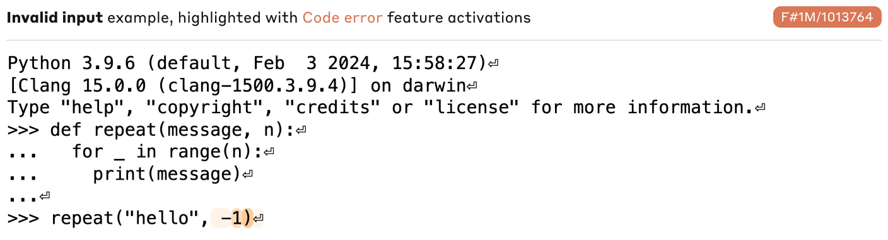

> ⬅️ 返回 [论文索引](../INDEX.MD) · [复杂代码特征](../results/4-sophisticated-features.md)

# Figure 014 — Code error feature: dataset example 2

A second example illustrates the range of contexts in which `1M/1013764` activates.
