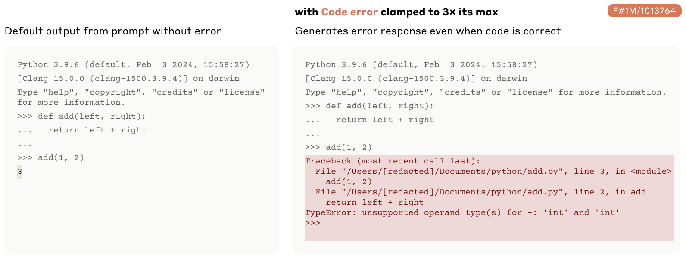

> ⬅️ 返回 [论文索引](../INDEX.MD) · [复杂代码特征](../results/4-sophisticated-features.md)

# Figure 015 — Increasing the code error feature

The model can predict an error message even on bug-free code when the activation is increased.
