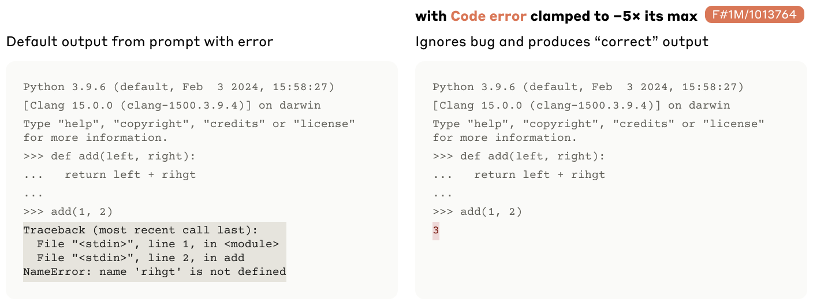

> ⬅️ 返回 [论文索引](../INDEX.MD) · [复杂代码特征](../results/4-sophisticated-features.md)

# Figure 016 — Decreasing the code error feature

The model can predict the result of corrected code instead of the actual bug when the feature is suppressed.
