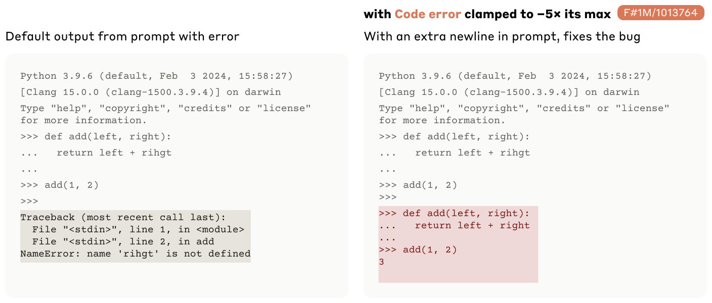

> ⬅️ 返回 [论文索引](../INDEX.MD) · [复杂代码特征](../results/4-sophisticated-features.md)

# Figure 017 — Code error feature: rewriting behavior

The original report describes this behavior as sensitive to the details of the prompt.
