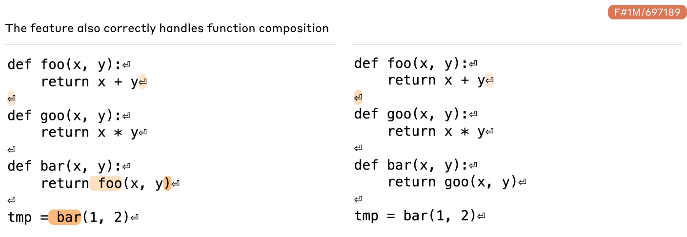

> ⬅️ 返回 [论文索引](../INDEX.MD) · [复杂代码特征](../results/4-sophisticated-features.md)

# Figure 019 — Function definition control

Comparing definitions with the same identifier helps separate sensitivity to functionality from sensitivity to the name.
