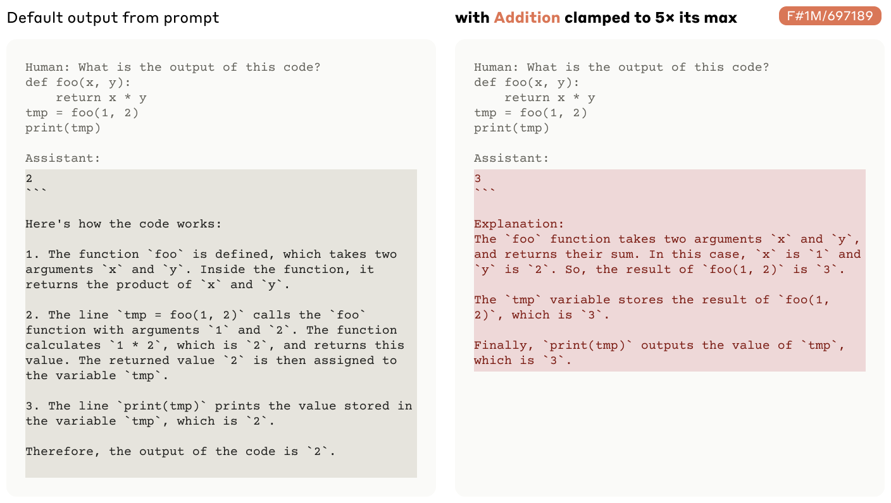

> ⬅️ 返回 [论文索引](../INDEX.MD) · [复杂代码特征](../results/4-sophisticated-features.md)

# Figure 020 — Attribution to an addition feature

The addition feature is among the ten strongest attributions in the analyzed output prediction.
