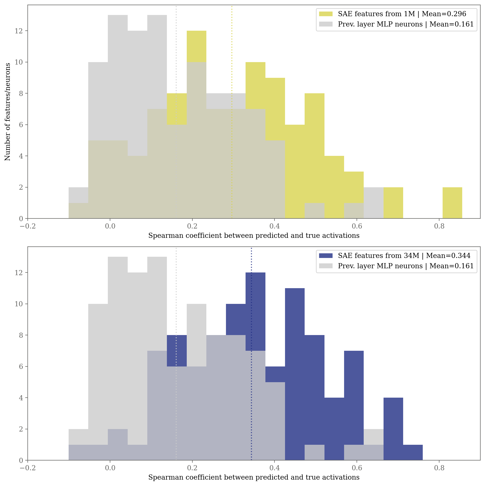

> ⬅️ 返回 [论文索引](../INDEX.MD) · [特征与神经元](../results/5-features-vs-neurons.md)

# Figure 021 — Automated interpretability comparison

An automated comparison uses 100 sampled SAE features and 100 neurons.
