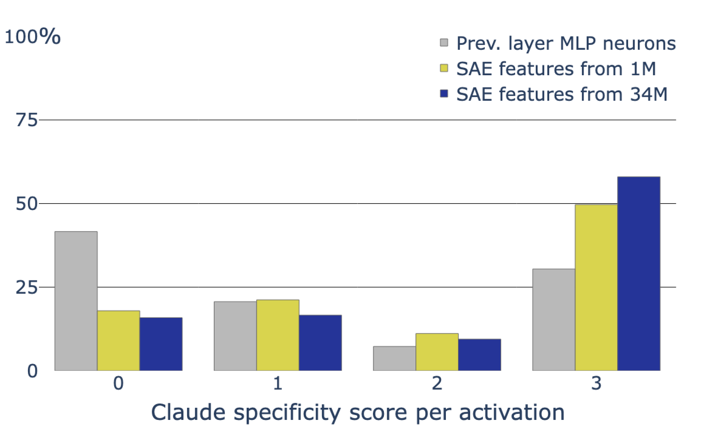

> ⬅️ 返回 [论文索引](../INDEX.MD) · [特征与神经元](../results/5-features-vs-neurons.md)

# Figure 022 — Specificity comparison

Random SAE features are more specific on the rubric than neurons sampled from the previous layer.
