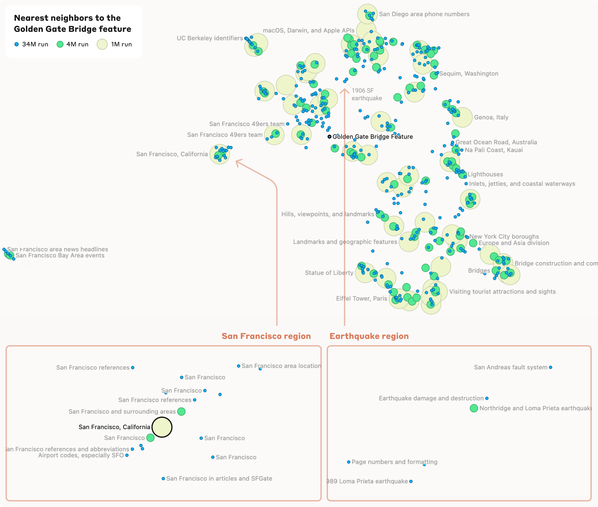

> ⬅️ 返回 [论文索引](../INDEX.MD) · [特征邻域](../results/6-neighborhoods.md)

# Figure 023 — Golden Gate Bridge neighborhood

Nearby decoder directions include San Francisco landmarks and, farther away, more loosely related destinations. The larger dictionaries contain finer-grained features.
