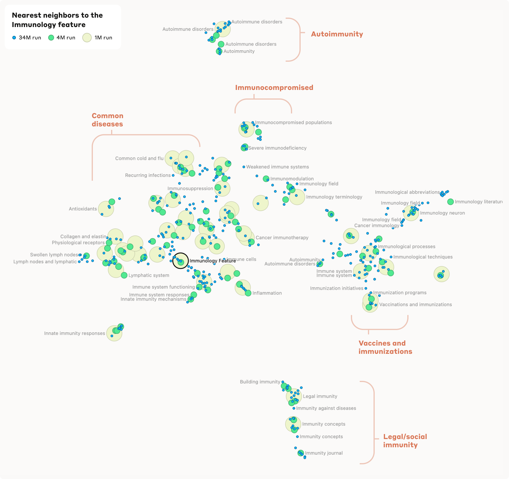

> ⬅️ 返回 [论文索引](../INDEX.MD) · [特征邻域](../results/6-neighborhoods.md)

# Figure 024 — Immunology neighborhood

The neighborhood contains clusters around immune conditions, immune responses, biomedical techniques, and non-medical senses of immunity.
