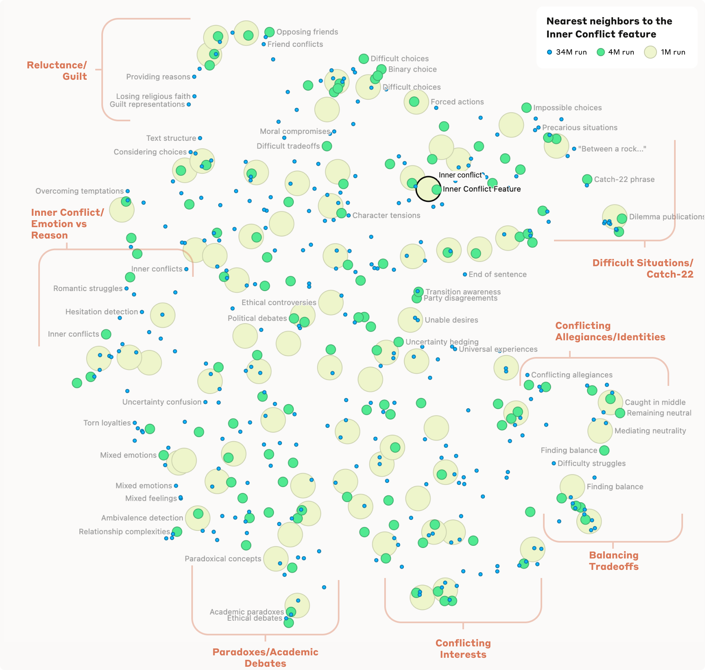

> ⬅️ 返回 [论文索引](../INDEX.MD) · [特征邻域](../results/6-neighborhoods.md)

# Figure 025 — Inner conflict neighborhood

Nearby subregions track trade-offs, opposing principles, and emotional conflict without sharply separated clusters.
