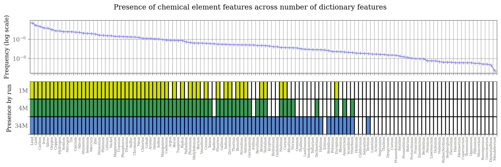

> ⬅️ 返回 [论文索引](../INDEX.MD) · [字典覆盖率](../results/7-completeness.md)

# Figure 026 — Coverage of chemical elements

Larger dictionaries tend to contain dedicated features for less frequently mentioned elements.
