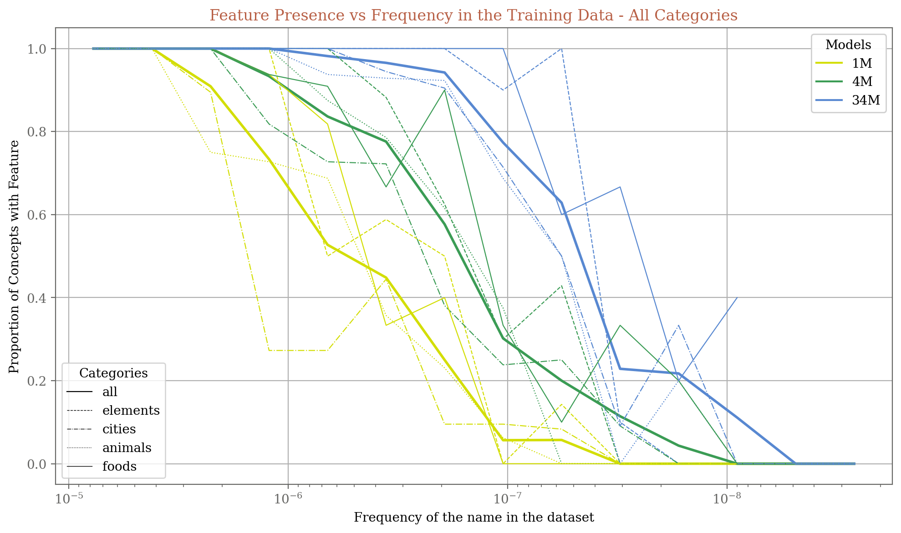

> ⬅️ 返回 [论文索引](../INDEX.MD) · [字典覆盖率](../results/7-completeness.md)

# Figure 027 — Concept coverage by corpus frequency

The relationship between frequency, dictionary width and feature detection recurs across concept categories.
