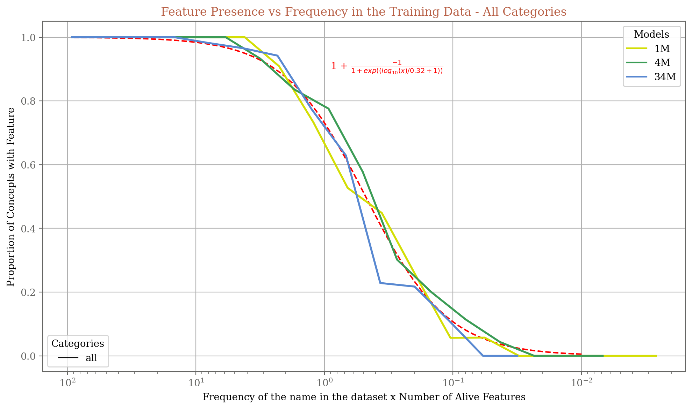

> ⬅️ 返回 [论文索引](../INDEX.MD) · [字典覆盖率](../results/7-completeness.md)

# Figure 028 — Coverage rescaled by alive features

Rescaling the frequency by the number of alive features makes the curves approximately overlap.
