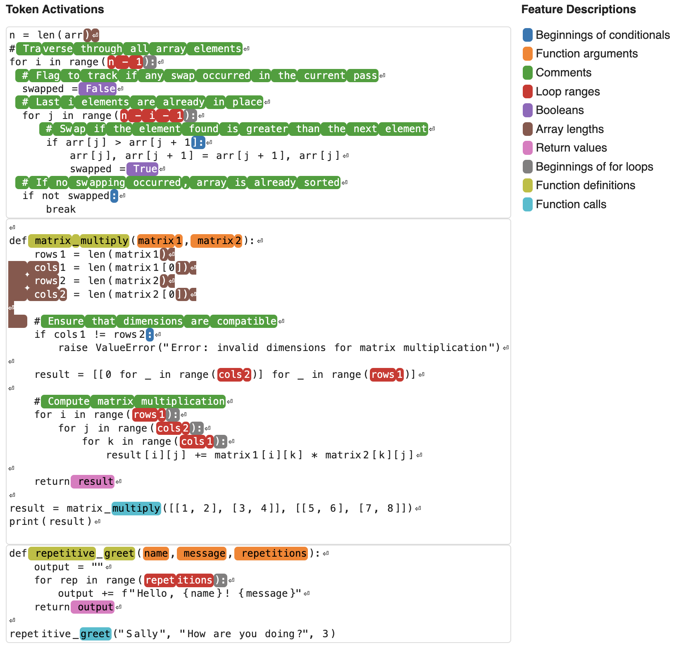

> ⬅️ 返回 [论文索引](../INDEX.MD) · [特征类别](../results/8-feature-categories.md)

# Figure 029 — Syntax-like highlights in code

Tokens are colored by whether each feature activates, not by its activation magnitude.
