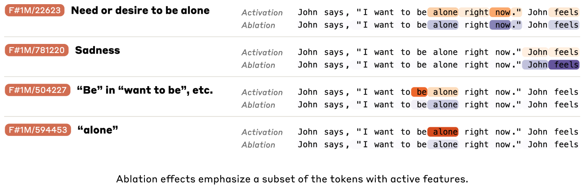

> ⬅️ 返回 [论文索引](../INDEX.MD) · [计算中间变量](../results/9-computational-intermediates.md)

# Figure 031 — Emotional inference

The analysis contrasts the completions “sad” and “happy” and recovers features for wanting to be alone and for sadness.
