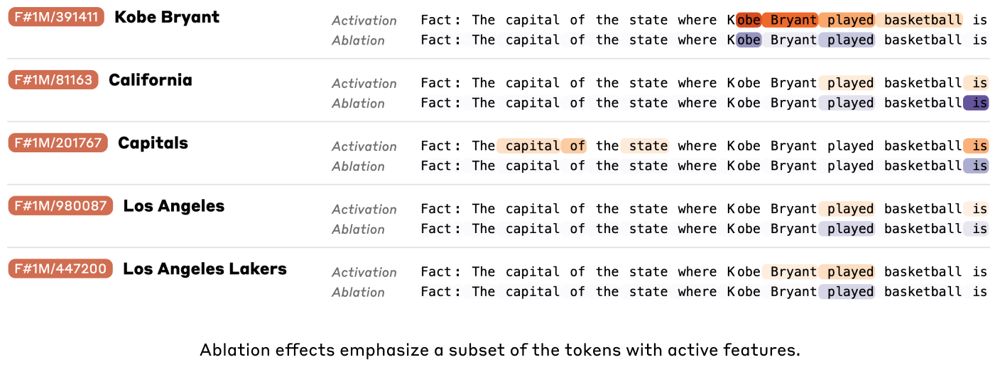

> ⬅️ 返回 [论文索引](../INDEX.MD) · [计算中间变量](../results/9-computational-intermediates.md)

# Figure 032 — Multi-step inference: ablation analysis

The target logit contrast is “Sacramento” versus “Albany.” Ablations test which features matter to that contrast.
