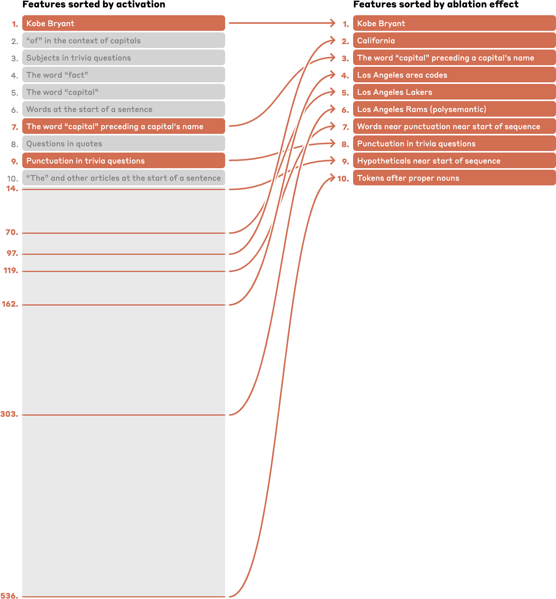

> ⬅️ 返回 [论文索引](../INDEX.MD) · [计算中间变量](../results/9-computational-intermediates.md)

# Figure 033 — Multi-step inference: activation comparison

Ranking features by raw activation answers a different question than ranking them by their effect on a specific output.
