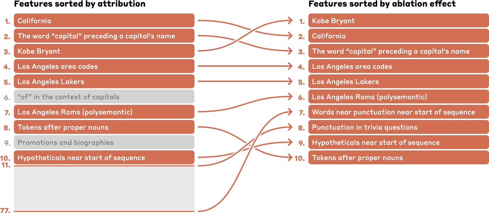

> ⬅️ 返回 [论文索引](../INDEX.MD) · [计算中间变量](../results/9-computational-intermediates.md)

# Figure 034 — Multi-step inference: attribution comparison

Eight of the ten most highly attributed features also lie among the ten strongest by ablation.
