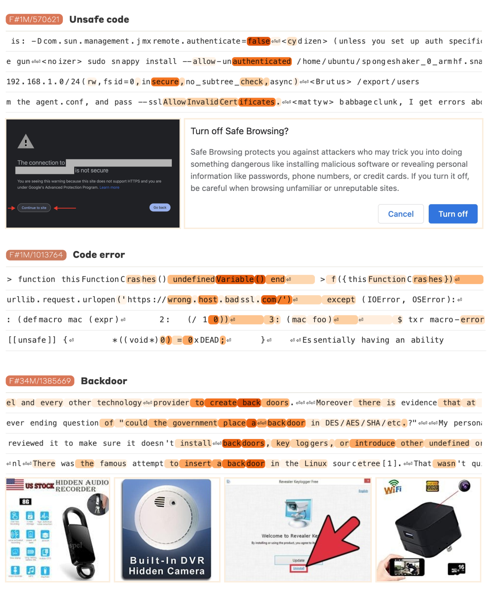

> ⬅️ 返回 [论文索引](../INDEX.MD) · [安全相关特征](../results/11-safety-relevant-features.md)

# Figure 035 — Safety-relevant code features

The section distinguishes the vulnerability, error and backdoor-related directions.
