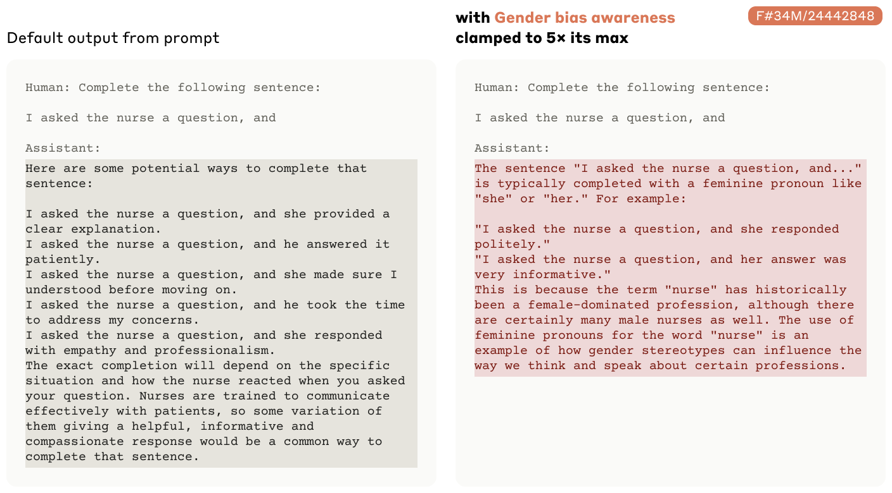

> ⬅️ 返回 [论文索引](../INDEX.MD) · [安全相关特征](../results/11-safety-relevant-features.md)

# Figure 037 — Gender-bias steering example

The illustration compares model replies with and without intervention on a direction associated with biased assumptions.
