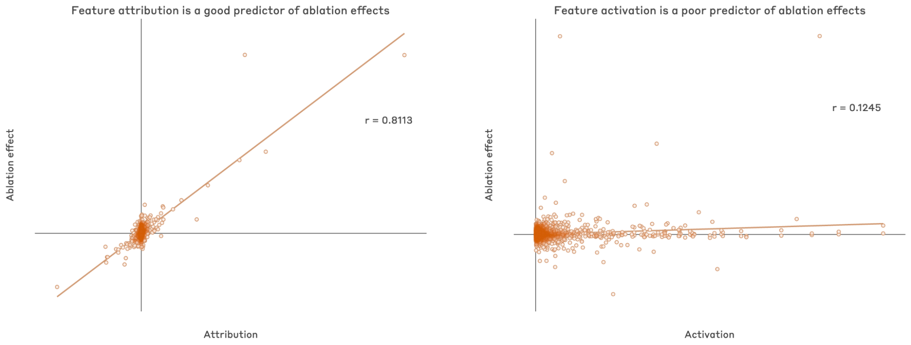

> ⬅️ 返回 [论文索引](../INDEX.MD) · [消融与归因](../results/12-ablation-and-attribution.md)

# Figure 044 — Ablation compared with attribution and activation

On the two evaluated prompts, attribution correlates with measured ablation much more strongly than raw activation does.
